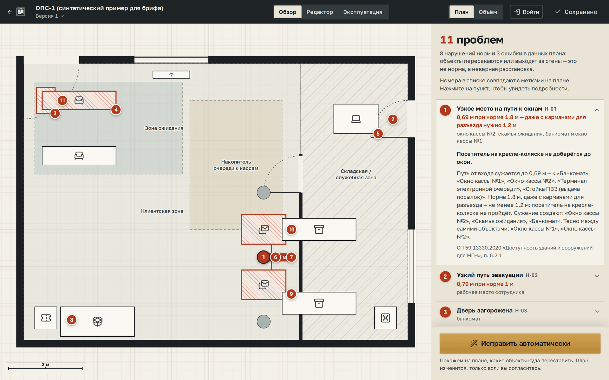
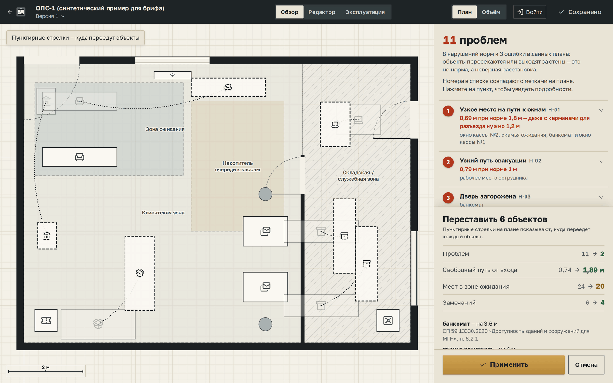
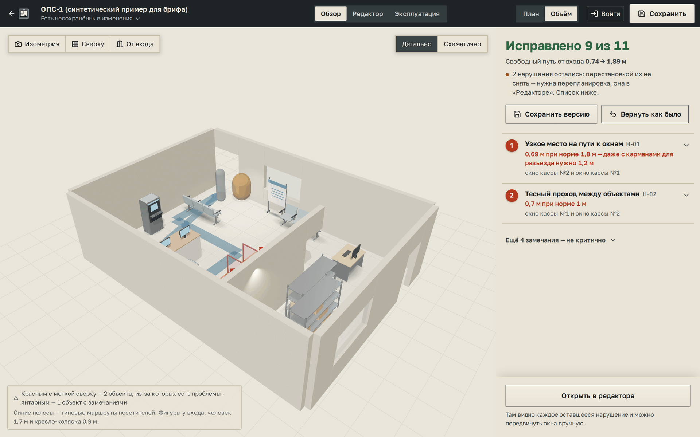
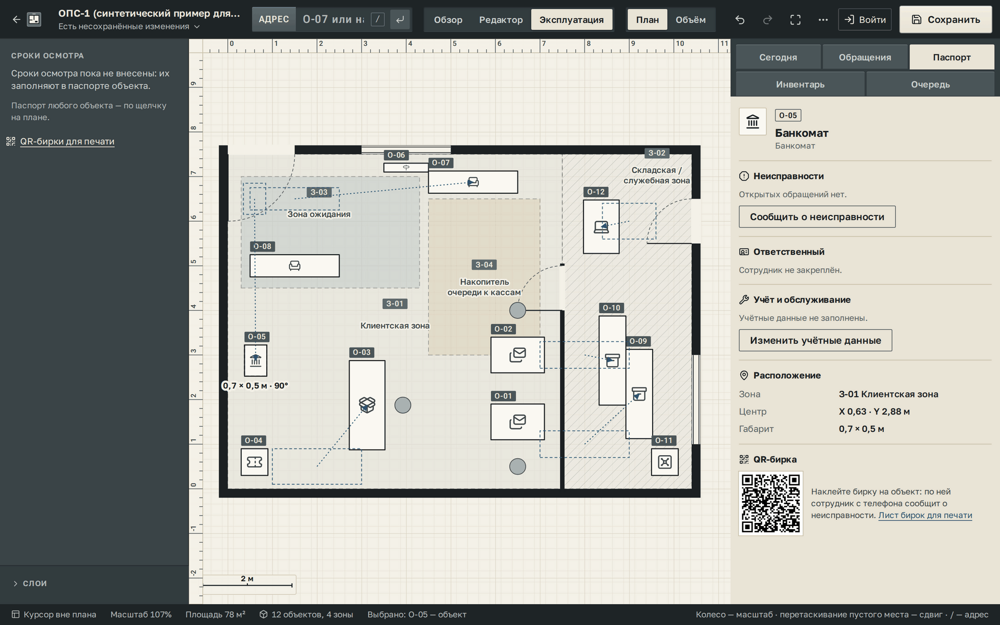

<div align="center">

# post-office-twin

**A floor plan of a post office that checks itself against the building code.**
Every finding is a measurement, a norm and a clause number — and the fix is shown before anything moves.

[](https://github.com/why-xdd/post-office-twin/actions/workflows/ci.yml)


**English** · [Русский](README.ru.md)

</div>

---

**Finalist of PostCode Challenge 2026** — the Russian Post engineering hackathon run by Pochtatech
and Innopolis University — in the track *“Digital twin of a Russian Post office”*. Built by team
«коломот»; the final defence was on 8 October 2026 in Innopolis.

Tens of thousands of Russian Post offices are waiting for renovation, and a year gets through a few
hundred. Today every redesign is paper, a site visit and a check by eye. The cost of a mistake is a
visitor in a wheelchair who cannot reach the counter, or a door that cannot be opened in a fire.

This is a web editor for the office plan that checks every change against five Russian regulatory
documents — postal facility design, accessibility and fire safety — while you work. It proposes a
layout without the violations, shows exactly what moves where and why, names what the fix costs,
and changes nothing until a person presses **Apply**.



<sub>The organisers' own sample plan, opened as-is. Every red number on the drawing is a line in the list; the measure sits exactly where the floor is narrowest.</sub>

---

## On the customer's own file

Every team got the same sample plan, [`data/example_plan.json`](data/example_plan.json). It opens with
no conversion, and fields the service does not know survive a save untouched.

| | Before | After **Fix automatically** |
|---|---:|---:|
| Problems (code violations and data errors) | 11 | **2** |
| Clear path from the entrance, norm 1.8 m | 0.74 m | **1.89 m** |
| Non-critical remarks | 6 | 4 |
| Waiting seats | 24 | 20 |

Six objects move, in about ten seconds on one core. The table above is what the panel shows *before*
anything is applied — including the price: four waiting seats.



<sub>Nothing has moved yet. Dashed arrows are the proposal; each move is listed with its distance and the rule it serves.</sub>

**Why it stops at two.** Both remaining violations sit between the two cashier windows, 0.7 m against
a 1.0 m norm. Those windows are built into the partition between the hall and the back office, with
cabling, cash equipment and security behind them. An earlier version of the engine "solved" this by
driving window №1 2.2 m into the middle of the hall and reporting zero. That office cannot be built,
so windows are now off-limits to the optimiser, and the service says plainly that what is left needs
a redesign rather than a rearrangement.

---

## How a problem is measured

**17 rules from five documents**: ВНТП 311-98 (postal facilities), СП 59.13330.2020 (accessibility),
the Ministry of Digital Development order № 538, СП 1.13130.2020 and Government Decree № 1479 (fire
safety). Each is listed with its exact value and clause in [`research/normatives.md`](research/normatives.md).

**Clearance is measured the way a wheelchair travels.** The free floor is eroded by half the norm with
*round* joins, which is exactly the space a disc of that diameter can sweep. The first version used
mitre joins; sharp corners under-reported diagonal gaps by up to 30 % and produced violations that did
not exist. On the customer's file that bug was the difference between 0.64 m and the real 0.74 m — and
the numbers in our own slides had to be redone.

**The number and the drawing are the same place.** For every path and evacuation finding the service
finds the narrowest segment between two obstacles and draws it with its size. Where the width is set by
a wall corner at the destination rather than by a passage, no measure is drawn: it would be a lie.

**Evacuation says two different things.** *Where* it is narrow (often at a window built into a wall)
and *what to move* to widen it (often a bench two metres away) are reported separately, because they
are usually different objects.

---

## The optimiser, and the model that only orders it

Candidate layouts are compared on one objective that includes code violations, wheelchair clearance,
the approach to every counter, waiting seats, the visitor's walking distance and how far equipment
moves ([`objective.py`](services/api/app/assistant/objective.py)). A violation is never removed by
quietly carrying the waiting-area bench out of the waiting area.

A new object has hundreds of possible spots, and a full check of all of them takes 13.9 s. So only
the top 24 are checked in full, and **a gradient-boosted model decides which 24**. Every spot that
reaches the answer still passes all 17 rules in full — the model orders, it never decides, so it
cannot propose something that breaks a norm.

End to end on 180 placement tasks over 26 plans the model never saw
([`benchmark_placement.py`](services/api/scripts/benchmark_placement.py)):

| Order of checking | Spots checked | Found the best spot | Time per task |
|---|---:|---:|---:|
| Exhaustive search | all | 100 % | 13.9 s |
| No model | 24 | 61 % | 1.19 s |
| **Two-headed model** | 24 | **94 %** | **1.23 s** |

The first head predicts "will this spot pass the full check", the second "is it in the best 5 % of its
list". The second head is switched off when rearranging existing objects, where it measurably made
results worse. After the fire-safety rules were added, a retrained model scored lower on the same
benchmark, so the older one still ships.

The trees live in a JSON file and the inference is plain numpy in one module,
[`accelerator.py`](services/api/app/assistant/accelerator.py): **the service has no machine-learning
dependency at runtime**. The training data — 667 233 labelled placements — is generated by the service
itself, on synthetic rooms and the two sample plans; real BTI plans were not allowed.

---

## Ask it in words

*«поставь огнетушитель у входа»*, *«убери банкомат»*, *«сколько окон обслуживания?»* — commands and
questions are parsed by the service itself ([`language.py`](services/api/app/assistant/language.py)),
tolerant of typos, and placed by the same search as everything else. The test battery is 31 phrases
it must understand and 10 it must refuse to guess.

A language model can replace the parser with three environment variables, any OpenAI-compatible
`/chat/completions` endpoint, cloud or on-premises. Its output is never trusted: equipment types, zones
and objects are checked against the plan, anything invented is dropped, and any failure falls back to
the parser. Without the variables the service runs fully offline.

---

## After the plan is approved



<sub>The same plan in 3D. Heights come from the equipment dictionary, not from guesses; colour is never the only signal.</sub>

- **QR tags.** Every object has a passport and a printable tag. Staff scan it with a phone and report a
  fault — no app, no login.
- **The morning summary.** What to do today, which counters are short at peak, what is broken. A counter
  reported as dead is counted as closed in the queue model straight away.
- **Queue at peak, on the plan.** M/M/c per hour from the electronic queue log; at 1.6× peak flow the
  queue is drawn into the hall and the evacuation width is re-checked with people in it.
- **1C reconciliation.** Export an inventory list, import the fixed-asset register, see what is missing,
  extra, misplaced or has a different serial number.
- **The network screen.** Every saved office ranked for renovation: a fire-safety violation weighs 5,
  accessibility 4, a counter physically missing at peak 4. The weights are shown on screen.
- **A hall camera without neural networks.** 75th-percentile background, blobs, a four-point homography
  onto the plan. On a synthetic 90-second recording: 10.4 visitors on average against 10.4 simulated.



---

## Engineering

- **Server** — Python 3.12, FastAPI, shapely, numpy. Plans in SQLite (WAL) or PostgreSQL, chosen by one
  environment variable; fields of the customer's format the service does not know are kept as they were,
  key order included.
- **Heavy work is bounded.** A semaphore admits heavy computations; the rest get `503` with
  `Retry-After` instead of piling up. The assistant has a 25-second budget and returns what it found,
  marked partial, rather than holding the user. Results are cached per document for 30 minutes.
- **Client** — React 19, TypeScript, Vite. three.js is a lazy chunk loaded only for the 3D view. The
  editor drags 500 objects at a 17.5 ms mean frame; the check runs after a pause, never inside a frame.
- **Auth** — PBKDF2-SHA256 with salt; the session cookie is HttpOnly and only a SHA-256 fingerprint of
  the token is stored. Failed logins are counted per address *and* login, so a stranger cannot lock the
  owner out. The author of every plan version is written by the server from the session, not by the client.
- **Tests** — 295 on the server (six of them need PostgreSQL; CI provides one) and 81 on the client.
- Every dependency is MIT, BSD or Apache-2.0.

---

## Run it

There is no hosted instance; everything runs locally.

```bash
docker compose up -d --build        # http://localhost:8000 — site, API, and /docs
```

For development:

```bash
cd services/api && uv sync && uv run uvicorn app.main:app --reload   # API on :8000
cd apps/web && npm install && npm run dev                           # client on :5173
```

The interface is in Russian. «Открыть пример» (*open example*) loads the demo office «Заречное»; to try
the organisers' sample plan, press «Загрузить свой план» (*upload your plan*) and pick
`data/example_plan.json`, or start the dev server with `OPS_TWIN_SAMPLE=../../data/example_plan.json`
so that the example button opens it. Demo staff accounts are created on first start;
see [README.ru.md](README.ru.md#эксплуатация-сотрудники-обращения-сегодня) for the logins and how to switch them off.

| Path | What is there |
|---|---|
| [`apps/web`](apps/web) | The editor, the operations screens, the 3D view |
| [`services/api`](services/api) | Plan storage, geometry, rules, the assistant, the model and its training scripts |
| [`data`](data) | The demo office, the organisers' sample format, a sample network, synthetic 1C, queue and camera data |
| [`research`](research) | Every rule with its value and clause |
| [`tools/models`](tools/models) | The Blender script that builds the 3D equipment models |
| [`deploy`](deploy) | A systemd unit and a one-command deploy to your own server; `render.yaml` for Render |

The full documentation — every rule, every screen, every measurement — is in Russian, the language of
the norms: **[README.ru.md](README.ru.md)**.

MIT © team «коломот»
